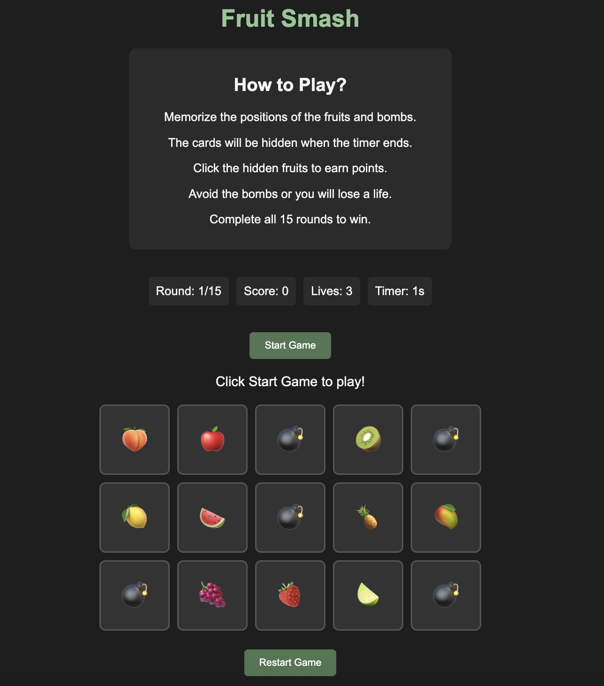

# Fruit Smash

### Game description

Fruit Smash is an arcade game where players click fruits to earn points while avoiding bombs to prevent losing lives. Players start with 3 lives and must complete 15 challenging rounds. At the beginning of each round, fruits and bombs appear in random positions for a few seconds before being hidden. The memorization time decreases as the player progresses through the game. The goal is to survive and successfully complete all 15 rounds.

## How to Play

- Click Start Game.
- Memorize fruits and bombs.
- Cards hide after the timer.
- Click fruits to earn points.
- Bombs remove one life.
- Find all fruits to complete the round.
- Complete 15 rounds to win.
- Lose all 3 lives = Game Over.
- Restart Game starts over.

## Difficulty

- Rounds 1-5: 1.5 seconds
- Rounds 6-10: 1 second
- Rounds 11-15: 0.5 seconds

## Technologies Used

- HTML
- CSS
- JavaScript

## Getting Started

- Full Game: [Play Fruit Smash](https://grobalada.github.io/fruit-smash/)
- Presentation Demo: [Play 2-Round Demo](https://grobalada.github.io/fruit-smash/demo/)
- Project Board: [Project Planning](https://github.com/users/grobalada/projects/1)

## Attributions

- Fisher-Yates shuffle algorithm - implementation generated with assistance from Google AI.

## Next Steps

- Add sound effects.
- Add a best-score system.
- Add card animations.
- Add different difficulty modes.